# Manual de usuario de NailsSpa

NailsSpa es el sistema de gestión y control interno del inventario de un spa de uñas. Este manual explica, paso a paso, cómo usar cada pantalla según el rol de la persona que ingresa: **Administrador**, **Gerente** o **Manicurista**.

> **Sobre las capturas.** Las imágenes muestran la aplicación con datos de prueba. Los círculos y recuadros rojos numerados señalan dónde hacer clic o qué mirar en cada paso; debajo de cada imagen está la lista de las marcas. Los datos personales se ocultaron.

## Contenido

1. [Qué puede hacer cada rol](#1-qué-puede-hacer-cada-rol)
2. [Ingresar, salir y recuperar la contraseña](#2-ingresar-salir-y-recuperar-la-contraseña)
3. [Manual para el Administrador](#3-manual-para-el-administrador)
4. [Manual para el Gerente](#4-manual-para-el-gerente)
5. [Manual para la Manicurista](#5-manual-para-la-manicurista)
6. [Mensajes frecuentes y qué hacer](#6-mensajes-frecuentes-y-qué-hacer)
7. [Consejos de accesibilidad](#7-consejos-de-accesibilidad)

## 1. Qué puede hacer cada rol

NailsSpa muestra solo las opciones que corresponden a tu rol. Si una opción no aparece en el menú, tu rol no tiene permiso para usarla.

| Opción | Administrador | Gerente | Manicurista |
|---|:-:|:-:|:-:|
| Inventario: consultar | Sí | Sí | Sí |
| Inventario: crear, editar y descontinuar productos | Sí | No | No |
| Detalle del producto con kardex valorizado | Sí | Sí | No |
| Registrar movimiento: entrada | Sí | No | No |
| Registrar movimiento: salida | Sí | No | Sí |
| Historial de movimientos | Todos | Todos | Solo los propios |
| Anular un movimiento | Sí | No | No |
| Alertas: lista de productos por reponer | Sí | Sí | Sí |
| Tablero de decisiones, exportar datos y proveedores cercanos | Sí | Sí | No |
| Proveedores: consultar | Sí | Sí | Sí |
| Proveedores: crear, editar, activar y desactivar | Sí | No | No |
| Usuarios | Sí | Sí | No |

> **Nota.** El Gerente consulta y analiza, pero no registra movimientos ni modifica el catálogo. La Manicurista registra salidas de insumos y consulta lo que ella misma registró.

## 2. Ingresar, salir y recuperar la contraseña

### 2.1 Ingresar

1. Abre la dirección de NailsSpa en el navegador. Aparece la pantalla **Ingresar**.
2. Escribe tu **Correo** y tu **Contraseña**.
3. Pulsa **Ingresar**. Si todo está bien, entras a la pantalla de **Inventario**.

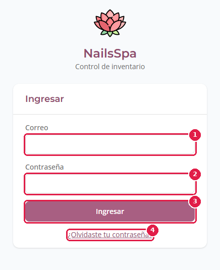

*Marcas rojas: **1** Correo · **2** Contraseña · **3** Ingresar · **4** ¿Olvidaste tu contraseña?*

Si ves **«Correo o contraseña incorrectos.»**, revisa que el correo esté bien escrito y vuelve a intentarlo. Si tu usuario fue desactivado, pide al Administrador que lo active.

### 2.2 Cerrar sesión

Pulsa **Salir**, en la parte superior derecha. La sesión también se cierra sola a los **30 minutos**; si pasa, vuelve a ingresar.

### 2.3 Recuperar la contraseña

Si olvidaste tu contraseña:

1. En la pantalla de ingreso, pulsa **¿Olvidaste tu contraseña?**.
2. Escribe tu **Correo** y pulsa **Enviar enlace**. La pantalla muestra siempre el mismo mensaje, exista o no la cuenta: así se protege la privacidad de los usuarios.

   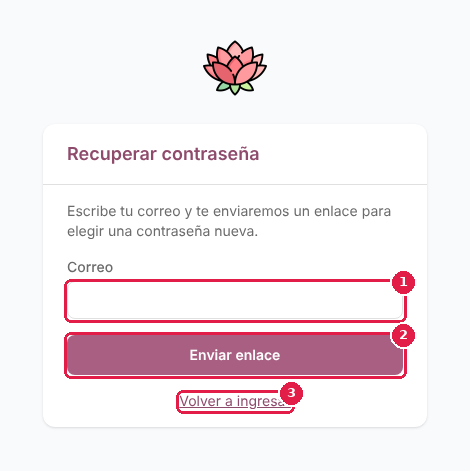

   *Marcas rojas: **1** Correo · **2** Enviar enlace · **3** Volver a ingresar*

3. Abre el correo que recibes y pulsa el enlace. Te lleva a la pantalla **Nueva contraseña**.
4. Escribe la **Nueva contraseña** (mínimo 8 caracteres) y repítela en **Repite la contraseña**. Las dos deben coincidir.
5. Pulsa **Guardar contraseña**.

   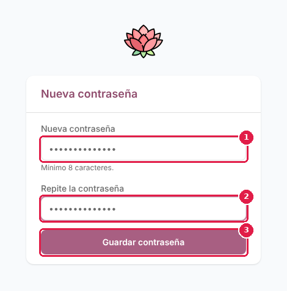

   *Marcas rojas: **1** Nueva contraseña · **2** Repite la contraseña · **3** Guardar contraseña*

6. Aparece **«Contraseña actualizada»** con el mensaje «Listo. Ya puedes ingresar con tu nueva contraseña.». Pulsa **Ir a ingresar** y entra con la nueva clave.

   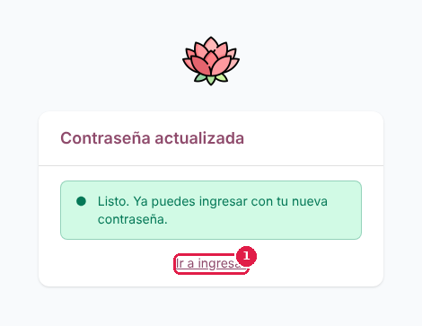

   *Marcas rojas: **1** Ir a ingresar*

Si el enlace del correo venció o ya se usó, la pantalla te avisa y te deja pedir otro desde el paso 2. Si no te llega el correo, revisa la carpeta de spam y espera unos minutos antes de pedirlo de nuevo. En cualquier momento puedes volver con el enlace **Volver a ingresar**.

## 3. Manual para el Administrador

El Administrador tiene acceso a todas las opciones del menú: **Inventario**, **Registrar movimiento**, **Historial**, **Alertas y tablero**, **Proveedores** y **Usuarios**.

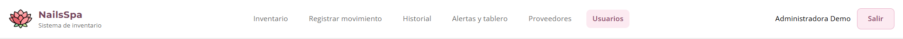

### 3.1 Consultar el inventario

1. Pulsa **Inventario** en el menú.
2. La tabla muestra **Código**, **Producto**, **Categoría**, **Stock actual**, **Stock mínimo**, **Estado** y **Acciones**.
3. Para encontrar un producto, usa los **Filtros del inventario**:
   - Escribe en **Buscar** el nombre o el código.
   - Elige una **Categoría** o **Todas las categorías**.
   - Elige un **Estado** o **Todos los estados**.
   - Marca **Incluir productos descontinuados** si quieres verlos.
4. Debajo de la tabla ves la página y el total de productos. Usa **Anterior** y **Siguiente** para cambiar de página.

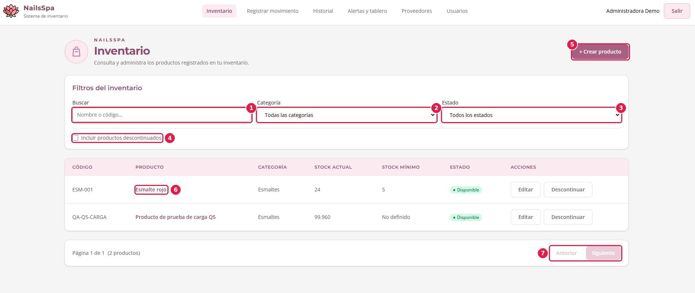

*Marcas rojas: **1** Buscar · **2** Categoría · **3** Estado · **4** Incluir productos descontinuados · **5** + Crear producto · **6** Nombre del producto (abre el detalle) · **7** Anterior y Siguiente*

El **Estado** se muestra con ícono y texto, no solo con color:

| Estado | Qué significa |
|---|---|
| ● Disponible | Hay existencias por encima del stock mínimo. |
| ▲ Bajo stock | El stock actual está en el mínimo o por debajo. Conviene reponer. |
| ■ Agotado | No quedan existencias. |
| — Descontinuado | El producto ya no se maneja; se conserva su historial. |

### 3.2 Ver el detalle de un producto y su kardex

Esta opción es para el Administrador y el Gerente.

1. En la tabla, pulsa el **nombre del producto**.
2. Se abre el detalle con el **kardex valorizado (costo promedio ponderado)**: cada entrada y salida con su cantidad, costo unitario, costo total, saldo, costo promedio y valor del saldo. Al final aparecen el **saldo final** y el **valor final**.
3. Para acotar el periodo, completa **Desde** y **Hasta** y pulsa **Filtrar**.
4. Para volver, pulsa **← Volver al inventario**.

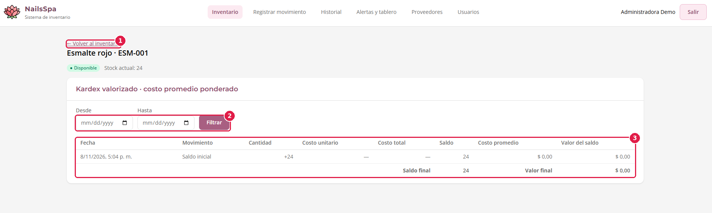

*Marcas rojas: **1** ← Volver al inventario · **2** Desde, Hasta y Filtrar · **3** Kardex valorizado*

El costo se calcula por **costo promedio ponderado**: cada vez que entra mercancía con costo, el promedio se recalcula. Las salidas se valoran al promedio vigente.

### 3.3 Crear un producto

1. En **Inventario**, pulsa **+ Crear producto**.
2. Completa el formulario. Los campos con asterisco (\*) son obligatorios:
   - **Código** (por ejemplo, ESM-001). No puede repetirse.
   - **Nombre** (por ejemplo, Esmalte rojo).
   - **Descripción** (opcional).
   - **Categoría** y **Unidad de medida**.
   - **Cantidad inicial**, si el producto ya tiene existencias. Se registra como saldo inicial.
   - **Stock mínimo** (opcional): la cantidad mínima antes de generar una alerta. Si lo dejas vacío, el producto no genera alertas.
3. Pulsa **Guardar producto**. Aparece un aviso de éxito y el producto queda en la tabla.

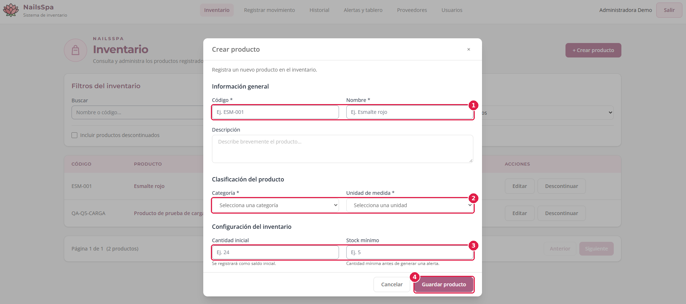

*Marcas rojas: **1** Código y Nombre · **2** Categoría y Unidad de medida · **3** Cantidad inicial y Stock mínimo · **4** Guardar producto*

Si el código ya existe, la pantalla lo indica y no guarda el producto. Si un campo está mal, el mensaje aparece debajo de ese campo.

### 3.4 Editar, descontinuar y reactivar un producto

- **Editar:** pulsa **Editar** en la fila del producto, cambia los datos y pulsa **Guardar producto**. Si otra persona modificó el mismo producto mientras lo editabas, la pantalla te pide recargar y repetir el cambio.
- **Descontinuar:** pulsa **Descontinuar** cuando el producto ya no se vaya a usar. No se borra: queda marcado y se conserva su historial.
- **Reactivar:** con **Incluir productos descontinuados** marcado, pulsa **Reactivar** para volver a usarlo.

### 3.5 Registrar un movimiento (entrada o salida)

1. Pulsa **Registrar movimiento** en el menú.
2. Elige **Registrar entrada** (llegó mercancía) o **Registrar salida** (se consumió o se dio de baja). Se abre el formulario.
3. Completa el formulario. Los campos con asterisco (\*) son obligatorios:
   - **Producto**.
   - **Motivo del movimiento**.
   - **Cantidad**.
   - Si es una entrada con motivo **Compra a proveedor**, también el **Costo unitario** y el **Proveedor**. El costo unitario debe ser el costo neto de compra (precio menos descuentos, más transporte y otros costos directos).
   - **Observaciones** (opcional).
4. Pulsa **Registrar movimiento**. Aparece un aviso de éxito. Para descartar el formulario, pulsa **Cancelar**.

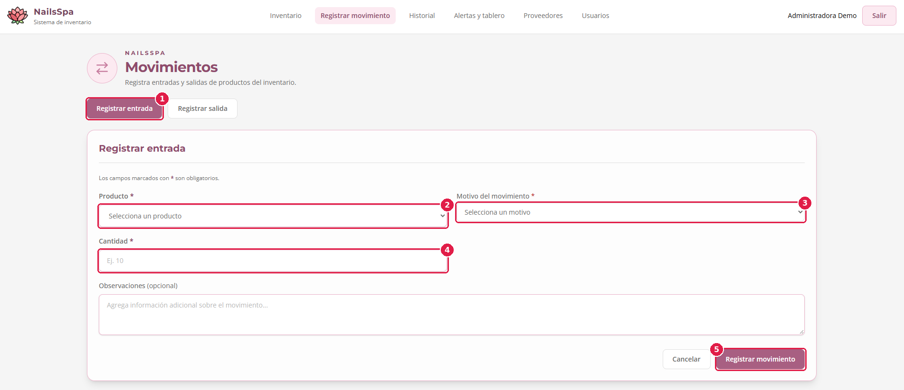

*Marcas rojas: **1** Registrar entrada · **2** Producto · **3** Motivo del movimiento · **4** Cantidad · **5** Registrar movimiento*

Si después del movimiento el producto queda con stock bajo o agotado, el aviso te lo dice. Si intentas sacar más cantidad de la que hay, la pantalla muestra que el stock es insuficiente y no registra nada. Pulsar el botón dos veces no duplica el movimiento.

### 3.6 Consultar el historial y anular un movimiento

1. Pulsa **Historial** en el menú. La tabla **Movimientos registrados** muestra **Fecha**, **Producto**, **Tipo** (Entrada, Salida o Anulación), **Motivo**, **Cantidad**, **Saldo** y **Acciones**, y el total de registros.
2. Para filtrar, usa **Filtrar movimientos**: **Producto**, **Tipo de movimiento**, **Desde** y **Hasta**. Pulsa **Limpiar filtros** para quitarlos.
3. Usa **Anterior** y **Siguiente** para cambiar de página.

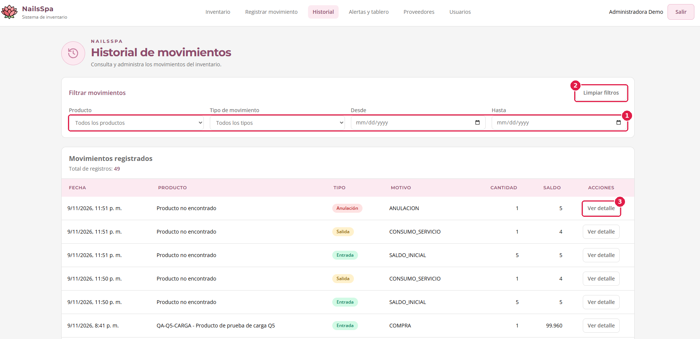

*Marcas rojas: **1** Filtros · **2** Limpiar filtros · **3** Ver detalle*

Para ver un movimiento completo, pulsa **Ver detalle**. Se abre el **Detalle del movimiento** con el producto, el tipo, la fecha, el motivo, la cantidad, el saldo resultante, el costo unitario y la observación.

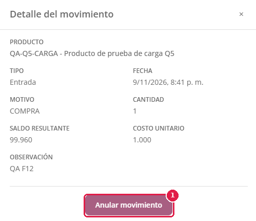

*Marcas rojas: **1** Anular movimiento*

**Anular un movimiento registrado por error** (solo el Administrador):

1. En el detalle, pulsa **Anular movimiento**.
2. En **Confirmar anulación**, escribe el **Motivo de la anulación** (mínimo 5 caracteres).
3. Pulsa **Confirmar anulación**.

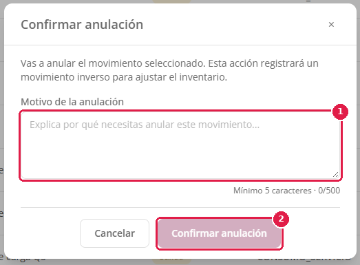

*Marcas rojas: **1** Motivo de la anulación · **2** Confirmar anulación*

Los movimientos no se borran: la anulación registra un movimiento inverso que ajusta el inventario y deja constancia. No se puede anular si el stock disponible ya no alcanza para revertirlo, o si el producto está descontinuado; en esos casos la pantalla te lo explica.

### 3.7 Alertas y tablero

Pulsa **Alertas y tablero**. La pantalla tiene cuatro partes.

**Productos por reponer.** Lista los productos que necesitan reponerse, con **Producto**, **Estado**, **Stock actual**, **Stock mínimo** y **Faltante**. Puedes filtrar por **Estado** (bajo stock o agotado). Solo aparecen productos que tienen stock mínimo definido. El número junto a **Alertas y tablero** en el menú indica cuántos productos están en alerta.

**Tablero de decisiones.** Muestra tres cifras y cuatro gráficos de los últimos 30 días, incluido hoy:

| Indicador | Para qué sirve |
|---|---|
| Valor del inventario | Cuánto vale el stock actual (existencias por costo promedio). Si no hay costos registrados, dice «Sin costos registrados». |
| Consumo de 30 días | Cuántas unidades salieron en el periodo. |
| Productos | Cuántos productos hay en el inventario. |
| Productos por estado | Cuántos productos hay disponibles, con bajo stock, agotados y descontinuados. |
| Top de rotación (30 días) | Los productos que más salen. |
| Consumo de 30 días por categoría o por producto | Qué se consume más. Cambia la agrupación con la lista **Agrupar el consumo por**. |
| Cobertura estimada (días) | Para cuántos días alcanza el stock al ritmo de consumo actual. El gráfico muestra los productos con menos cobertura. |

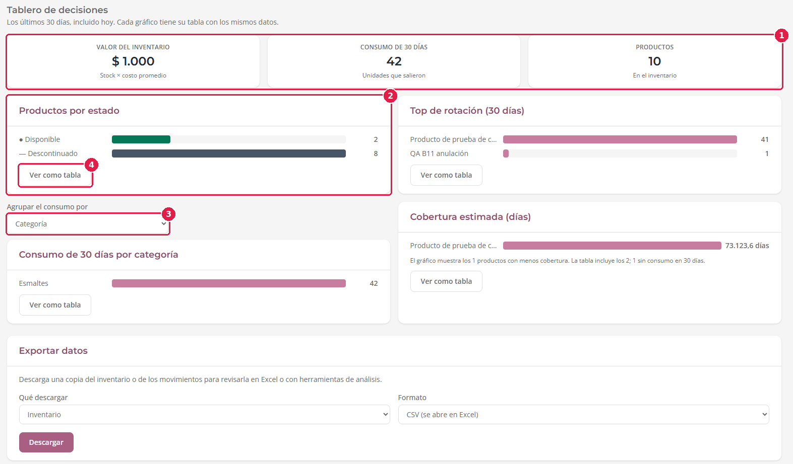

*Marcas rojas: **1** Cifras principales · **2** Gráfico · **3** Agrupar el consumo por · **4** Ver como tabla*

Cada gráfico tiene un botón **Ver como tabla** con los mismos datos, y **Ver gráfico** para volver.

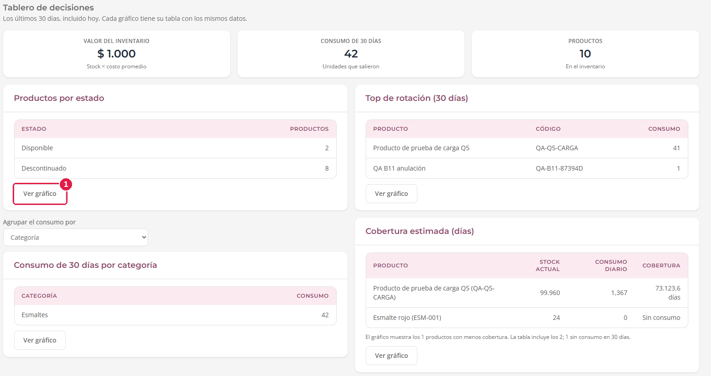

*Marcas rojas: **1** Ver gráfico*

**Exportar datos.** Descarga un archivo con el inventario o los movimientos:

1. En **Qué descargar**, elige **Inventario** o **Movimientos**.
2. En **Formato**, elige **CSV (se abre en Excel)** o **Parquet (análisis de datos)**.
3. Pulsa **Descargar**. Cuando el archivo está listo, aparece **«Descarga lista»** con su nombre, por ejemplo `inventario-20261108.csv`.

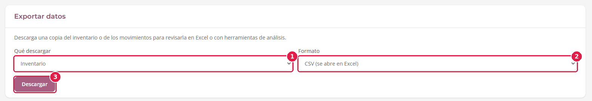

*Marcas rojas: **1** Qué descargar · **2** Formato · **3** Descargar*

**Proveedores cercanos.** Sirve para reponer los productos en alerta: busca los proveedores que están cerca de la sede.

1. Haz clic en el mapa, o escribe la **Latitud** y la **Longitud** del punto de búsqueda.
2. Ajusta el **Radio** en kilómetros con la barra.
3. Debajo del mapa aparece la lista de proveedores dentro del radio, con la distancia a cada uno. Pulsa **Descargar GeoJSON** para guardar el resultado.

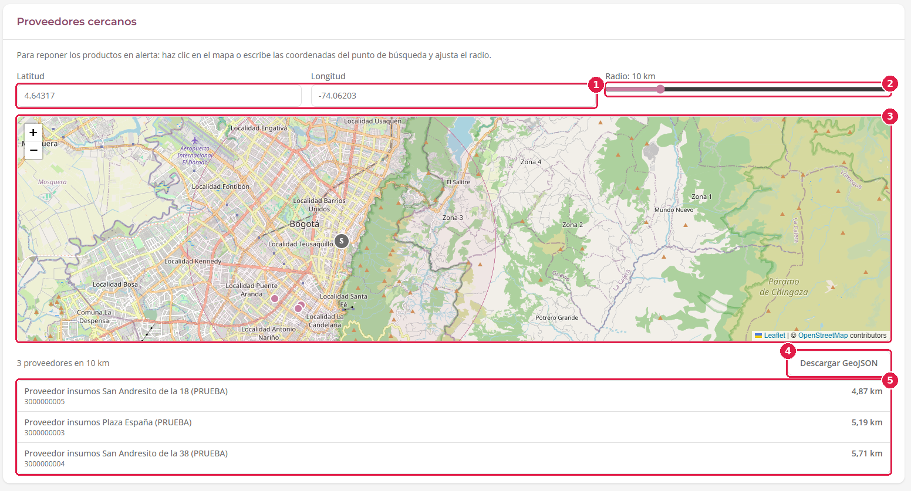

*Marcas rojas: **1** Latitud y Longitud · **2** Radio · **3** Mapa · **4** Descargar GeoJSON · **5** Lista de proveedores cercanos*

### 3.8 Gestionar proveedores

1. Pulsa **Proveedores**. Cada proveedor aparece en una tarjeta con su estado (**Activo** o inactivo), **NIT**, **Teléfono**, **Correo**, **Dirección** y **Ubicación**.
2. Marca **Mostrar proveedores inactivos** si quieres verlos también.
3. **Crear:** pulsa **Nuevo proveedor** y completa el formulario:
   - **Nombre del proveedor** y **NIT** son obligatorios. El NIT tiene el formato 900123456-7 y no puede repetirse.
   - **Teléfono**, **Correo electrónico** y **Dirección** son opcionales.
   - En **Ubicación del proveedor**, haz clic en el mapa para marcar el punto; debajo se muestran la latitud y la longitud.
   - Pulsa **Guardar proveedor**.
4. **Editar:** pulsa **Editar** en la tarjeta, cambia los datos y pulsa **Guardar proveedor**. El NIT no se puede modificar.
5. **Activar o desactivar:** pulsa **Desactivar** (o **Activar**) en la tarjeta. Los proveedores no se borran: al desactivarlos se conserva su historial.

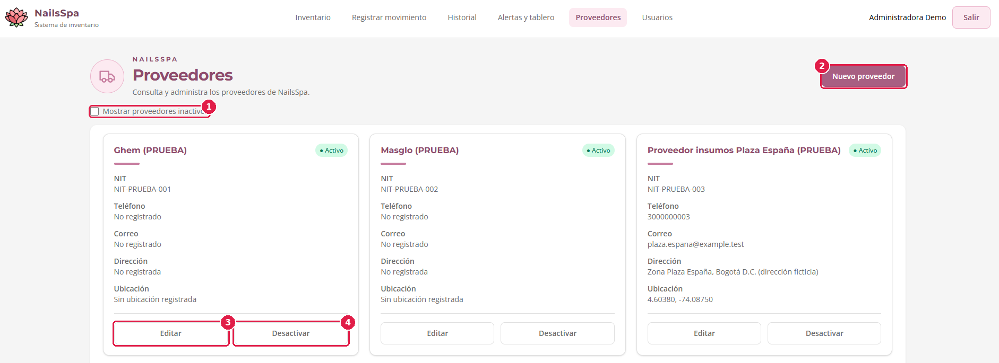

*Marcas rojas: **1** Mostrar proveedores inactivos · **2** Nuevo proveedor · **3** Editar · **4** Desactivar*

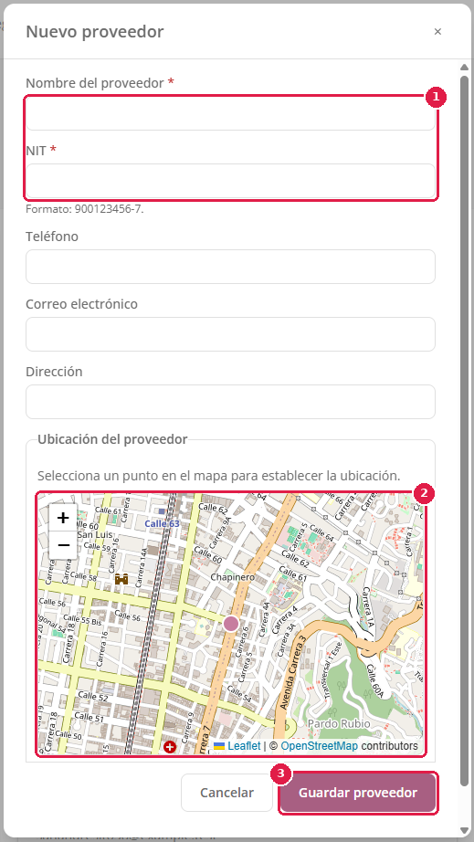

*Marcas rojas: **1** Nombre y NIT · **2** Mapa de ubicación · **3** Guardar proveedor*

### 3.9 Gestionar usuarios

1. Pulsa **Usuarios**. La tabla muestra **Nombre**, **Usuario** (correo), **Rol**, **Estado** y **Acciones**. Puedes ver 10, 25 o 50 usuarios por página con **Registros por página**.
2. **Crear un usuario:** pulsa **Nuevo usuario**, completa el nombre completo, el correo, el **Rol** y la **Contraseña temporal** (de 8 a 128 caracteres) y pulsa **Guardar**. Entrega la contraseña temporal a la persona por un medio seguro; luego puede cambiarla con **¿Olvidaste tu contraseña?**.
3. **Editar:** pulsa **Editar** en la fila para cambiar el nombre o el rol. El correo no se puede modificar.
4. **Activar o desactivar:** usa el interruptor de la fila. El cambio es inmediato. Los usuarios **no se borran**: al desactivarlos, ya no pueden ingresar, pero se conserva su historial. No puedes desactivar tu propia cuenta.

Los avisos de éxito se cierran solos a los pocos segundos; los de error se quedan hasta que los cierres.

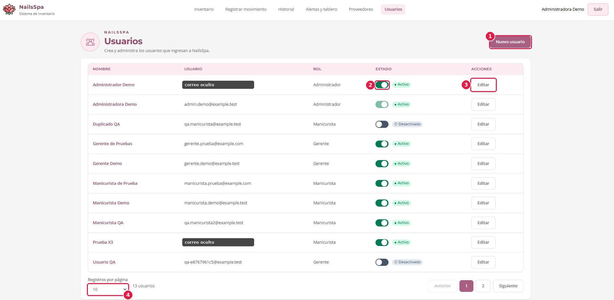

*Marcas rojas: **1** Nuevo usuario · **2** Interruptor de estado · **3** Editar · **4** Registros por página*

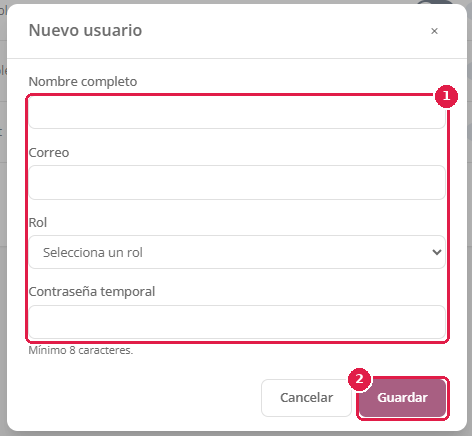

*Marcas rojas: **1** Campos del usuario · **2** Guardar*

## 4. Manual para el Gerente

El Gerente consulta y analiza la información. Su menú muestra **Inventario**, **Historial**, **Alertas y tablero**, **Proveedores** y **Usuarios**. No ve **Registrar movimiento**.

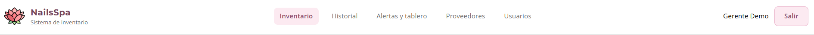

| Tarea | Dónde está |
|---|---|
| Consultar el inventario y filtrarlo | [3.1](#31-consultar-el-inventario) |
| Ver el detalle y el kardex valorizado de un producto | [3.2](#32-ver-el-detalle-de-un-producto-y-su-kardex) |
| Consultar el historial de todos los movimientos | [3.6](#36-consultar-el-historial-y-anular-un-movimiento) (solo consulta; no puede anular) |
| Revisar las alertas, el tablero de decisiones, exportar datos y ver los proveedores cercanos | [3.7](#37-alertas-y-tablero) |
| Consultar los proveedores | [3.8](#38-gestionar-proveedores) (solo consulta) |
| Gestionar usuarios | [3.9](#39-gestionar-usuarios) |

Lo que el Gerente **no** puede hacer: crear, editar o descontinuar productos; registrar entradas o salidas; anular movimientos; y crear, editar o desactivar proveedores. En esas pantallas no verá los botones correspondientes (**+ Crear producto**, **Editar**, **Descontinuar**, **Anular movimiento**, **Nuevo proveedor**).

## 5. Manual para la Manicurista

La Manicurista registra el consumo de insumos y revisa qué hay disponible. Su menú muestra **Inventario**, **Registrar movimiento**, **Historial**, **Alertas y tablero** y **Proveedores**. No ve **Usuarios**.

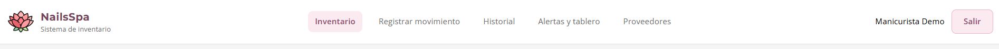

### 5.1 Consultar el inventario

Funciona igual que en [3.1](#31-consultar-el-inventario), solo para consulta: no aparecen los botones para crear, editar ni descontinuar, y el detalle con el kardex valorizado es solo para el Administrador y el Gerente.

### 5.2 Registrar una salida

Cuando uses un insumo, regístralo para que el inventario siga al día.

1. Pulsa **Registrar movimiento**, y luego **Registrar salida**.
2. Elige el **Producto** y el **Motivo del movimiento**.
3. Escribe la **Cantidad** que usaste.
4. Agrega una **Observación** si hace falta y pulsa **Registrar movimiento**.
5. Verás un aviso de éxito. Si el producto queda con stock bajo o agotado, el aviso te lo indica; avísale al Administrador para que lo reponga.

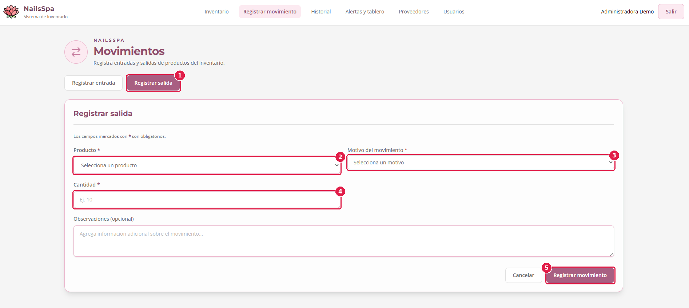

*Marcas rojas: **1** Registrar salida · **2** Producto · **3** Motivo del movimiento · **4** Cantidad · **5** Registrar movimiento. La captura se tomó con el Administrador, que ve los dos botones; la Manicurista solo ve **Registrar salida**.*

Si escribes más cantidad de la que hay, la pantalla muestra que el stock es insuficiente y no registra nada.

### 5.3 Ver mis movimientos

En **Historial** ves solo los movimientos que tú registraste. Puedes filtrarlos y pulsar **Ver detalle** para ver cada uno, como se explica en [3.6](#36-consultar-el-historial-y-anular-un-movimiento). Si registraste algo por error, pídele al Administrador que lo anule: la Manicurista no puede anular movimientos.

### 5.4 Revisar las alertas

En **Alertas y tablero** ves la lista de productos por reponer, con su estado, stock actual, stock mínimo y faltante. No ves el tablero de decisiones, la exportación ni el mapa de proveedores cercanos, que son para el Administrador y el Gerente.

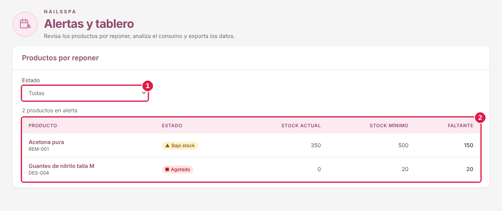

*Marcas rojas: **1** Estado · **2** Lista de productos por reponer*

### 5.5 Consultar proveedores

En **Proveedores** puedes ver los datos de contacto de cada proveedor. Solo el Administrador puede crearlos, editarlos o desactivarlos.

## 6. Mensajes frecuentes y qué hacer

| Mensaje | Qué significa | Qué hacer |
|---|---|---|
| Correo o contraseña incorrectos. | Los datos no coinciden. | Revisa el correo y la contraseña, o usa **¿Olvidaste tu contraseña?**. |
| Tu sesión venció. Vuelve a ingresar. | Pasaron 30 minutos de sesión. | Ingresa de nuevo. |
| No hay conexión con el servidor. | No se pudo comunicar con el sistema. | Revisa tu conexión a internet y reintenta con el botón **Reintentar**. |
| No tienes permiso para… | Tu rol no puede hacer esa acción. | Pídele al Administrador que la haga o que revise tu rol. |
| El código ya existe. | Hay otro producto con el mismo código. | Usa un código distinto. |
| Stock insuficiente. | Intentas sacar o anular más cantidad de la que hay. | Corrige la cantidad o revisa las existencias del producto. |
| Otra persona modificó este producto. | Dos personas editaron el mismo producto. | Recarga la página y repite el cambio. |
| El enlace venció o no es válido. | El enlace de recuperación ya no sirve. | Pide uno nuevo desde **Recuperar contraseña**. |

## 7. Consejos de accesibilidad

- Todo el sistema se puede usar con el teclado: **Tab** avanza, **Shift+Tab** retrocede, **Enter** o **Espacio** activan botones y **Esc** cierra las ventanas emergentes.
- Los estados del inventario siempre llevan ícono y texto, no solo color.
- Cada gráfico del tablero tiene su **tabla** con los mismos datos (botón **Ver como tabla**).
- Con zoom del navegador al 200 % el contenido sigue siendo legible; para ampliar, usa **Ctrl** y **+**.
